  
  

 

카티(kartee)입니다. 부산대학교 정보컴퓨터공학과에 다닙니다.

게임은 언리얼로, 앱은 안드로이드 스튜디오로 만들고 있습니다. 필요한 디스코드 봇은 파이썬으로 직접 짭니다.

C++ 위주로 공부한 내용은 [블로그](https://ka7-coding.tistory.com/)에 적어 둡니다.

## 지금까지

<table>
  <tr>
    <td width="50%" valign="top">
      <h3>군에 있을 때</h3>
      
      
      
2학년을 마치고 2025년 2월에 입대했습니다.

      
밀리패스는 군 장병과 가족, 군무원을 위한 모바일 신분인증·복지 플랫폼입니다. 이 앱과 마케팅 블로그를 기획했습니다. 코딩도 했고, 전화 민원 상담도 했습니다.

      
밀리패스 업무 추진 유공으로 소장급 상장을 받았습니다.

    </td>
    <td width="50%" valign="top">
      <h3>전역하고 나서</h3>
      
      
      
AI·SW 마에스트로 예비캠프에서 팀을 맡고 있습니다. 아래 정리함이 저희 팀 프로젝트입니다.

    </td>
  </tr>
</table>

## 만들고 있는 것

<table>
  <tr>
    <td width="50%" valign="top">
      <h3>DONT TRUST THE SHELF</h3>
      
      
      
한국어 제목은 믿음마트입니다. 편의점 ‘믿음마트’가 배경인 개인 게임입니다.

      
패치노트는 제가 만든 디스코드 봇으로 관리합니다.

    </td>
    <td width="50%" valign="top">
      <h3>갓생 가스라이터</h3>
      
      
혼자 만들면서 테스트하는 앱입니다.

    </td>
  </tr>
  <tr></tr>
  <tr>
    <td width="50%" valign="top">
      <h3>게임 제보 · AI 수정 요청 정리함</h3>
      
      
      
AI 코딩 도구로 게임을 만드는 사람을 위한 서비스입니다.

      
플레이어 제보를 버전과 재현 조건별로 묶고, AI 코딩 도구에 넣을 수정 요청문으로 바꿔 줍니다. 수정은 필요한 만큼만 요청하게 하고, 돌아온 결과를 이해한 뒤에 수락할지 다시 요청할지 고를 수 있게 하려고 합니다.

    </td>
    <td width="50%" valign="top">
      <h3>Patch Note Bot / Big-O</h3>
      
      
      
Patch Note Bot은 게임이랑 여러 앱의 패치노트를 관리하는 개인 봇입니다.

      
Big-O는 팀원이 오늘 한 일을 적으면 AI가 요약해서 남겨 주는 팀용 봇입니다.

    </td>
  </tr>
</table>

## 쓰는 도구

<table>
  <tr>
    <td align="center">언어 </td>
    <td align="center">게임 </td>
    <td align="center">앱 </td>
    <td align="center">봇 </td>
    <td align="center">협업 </td>
  </tr>
</table>

 

연락은 메일로 주시면 됩니다.

